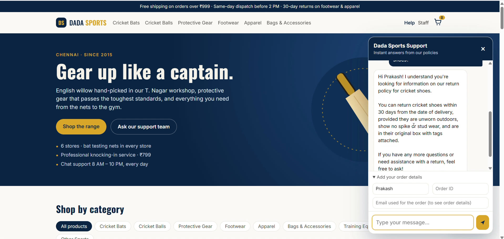
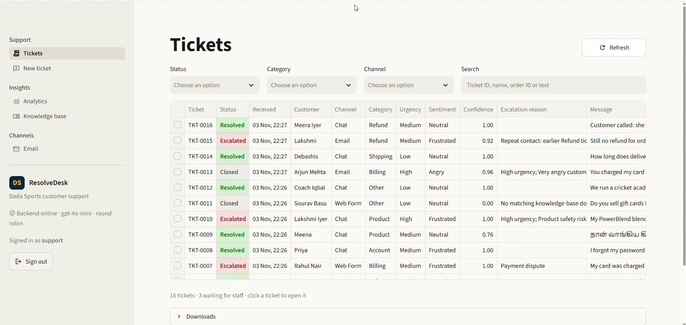
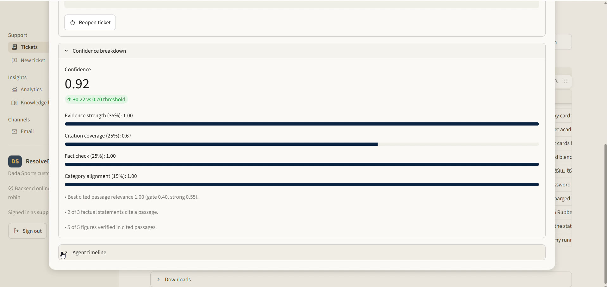
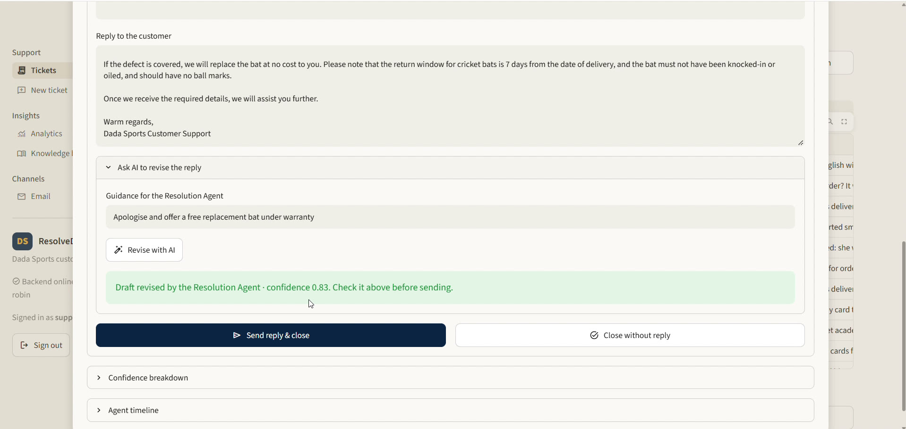
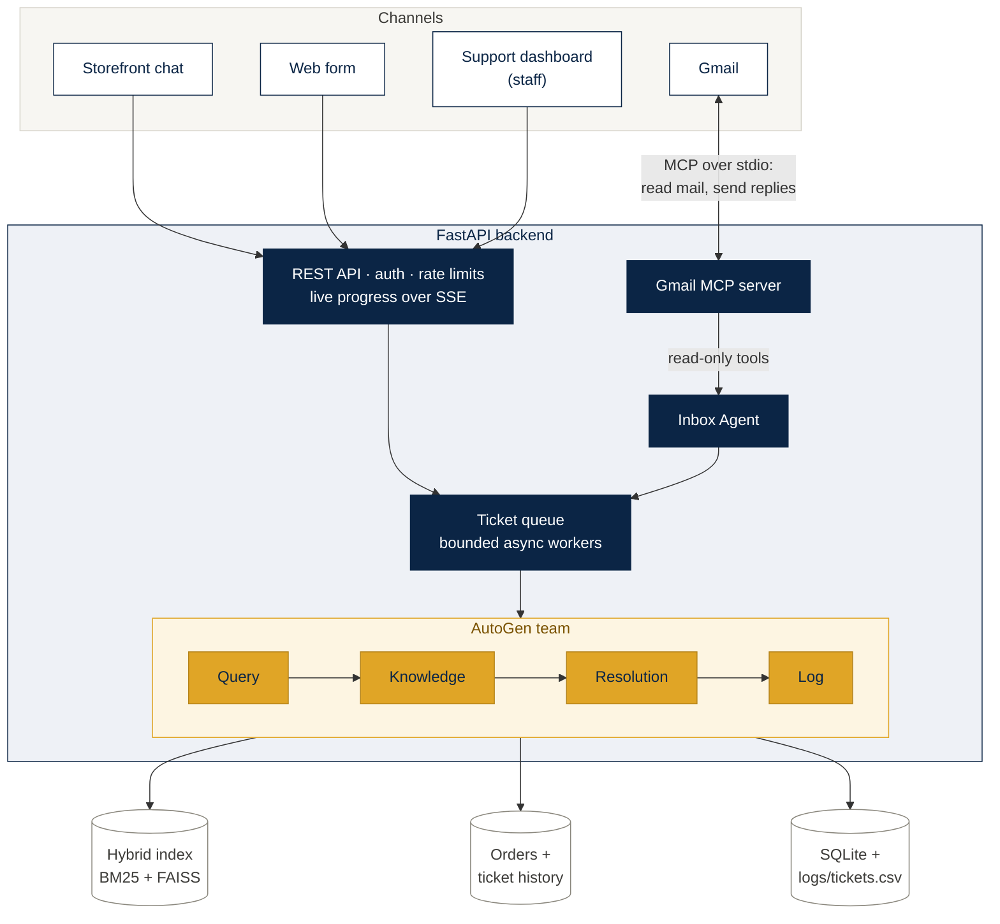
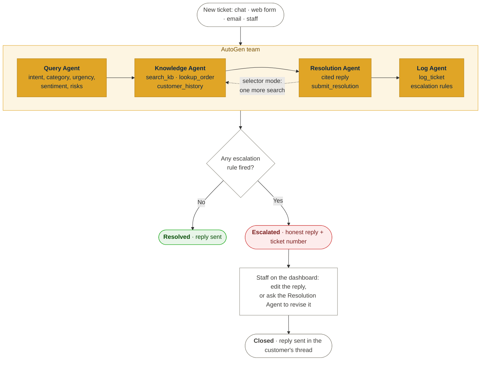
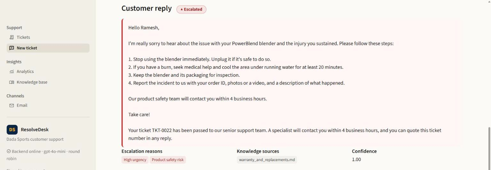
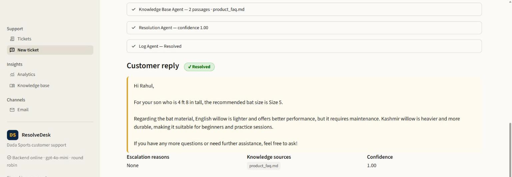

# ResolveDesk

**A multi-agent customer support desk built with AutoGen.** Four AI agents read every customer complaint, look up the answer in the company's own policies, write a grounded reply with an evidence-based confidence score, and either resolve the ticket or hand it to a human with a clear reason. Every ticket is logged.

ResolveDesk runs the support desk of **Dada Sports**, a Chennai-based cricket and sports retailer (fictional) with a full catalogue, six stores and detailed support policies.

<p align="center">
  
  
  
  
  
  
</p>

## Demo

https://github.com/user-attachments/assets/e295fab4-f46a-463c-96c9-df75f081e92e

<sub>3-minute walkthrough: storefront chat, web form and Gmail (MCP) channels, the support dashboard, explainable confidence, and a human revising an escalated reply with the Resolution Agent.</sub>

<table>
  <tr>
    <td width="50%"><br><sub><b>Storefront chat:</b> answered from the return policy, with the ticket number</sub></td>
    <td width="50%"><br><sub><b>Support dashboard:</b> Resolved, Escalated or Closed at a glance; click a ticket to work it</sub></td>
  </tr>
  <tr>
    <td><br><sub><b>Explainable confidence:</b> computed from evidence, citations and a fact check, never self-reported</sub></td>
    <td><br><sub><b>Human in the loop:</b> staff guidance, the Resolution Agent redrafts, then Send reply &amp; close</sub></td>
  </tr>
</table>

---

## The problem

An online store receives hundreds of complaints a day: late deliveries, refunds, damaged products, billing problems and login issues. Support staff answer the same questions repeatedly, answers drift from the actual policy, and the cases that really need a person get lost in the queue.

ResolveDesk answers routine tickets instantly **from the company's own documents**, refuses to guess when the documents don't cover a request, and routes risky or unclear cases to a human with the reason attached, so staff spend their time where judgement is needed.

## Features

**Four AutoGen agents with single, clear jobs**
- **Customer Query Agent** returns a validated triage: intent, category, urgency, sentiment, summary, product, language, risk flags, missing details.
- **Knowledge Base Agent** searches policies with a tool and publishes an evidence pack quoting the documents verbatim.
- **Resolution Agent** writes the reply from that evidence only, with `[S#]` citations, and submits it for scoring.
- **Log Agent** applies the escalation policy, records the ticket and hands complex cases to humans.

**Grounding you can check**
- Hybrid retrieval: BM25 keywords + FAISS vectors, fused with Reciprocal Rank Fusion, plus a category boost. The FAISS index is saved in `faiss_index/`.
- A relevance gate rejects weak matches, so the system says "not found" honestly instead of stretching an unrelated policy.
- Every factual statement cites a passage. Citations are validated in code, and every figure (₹ amounts, days, hours) is checked against the cited text, across scripts (Tamil ௫ and Bengali ৫ both count as 5).

**Explainable confidence and escalation**
- Confidence is a weighted score of evidence strength, citation coverage, fact check and category alignment, shown component by component.
- Escalation rules are deterministic and tested, with a keyword safety net for risks the LLM misses.

**Two orchestration modes**
- `RoundRobinGroupChat`: fixed order Query → Knowledge → Resolution → Log.
- `SelectorGroupChat`: the same order enforced by a candidate function; at the one real decision point the model chooses between logging and one more search when evidence was weak.
- Both end on `TextMentionTermination("LOGGED")` with a `MaxMessageTermination` safety net.

**Knows the customer, safely**
- Asks for missing details (an order ID for a refund, photos for a damage claim) instead of implying anything was done.
- `lookup_order` reads the order record, which becomes citable evidence `[O1]`; `customer_history` finds earlier tickets, and a repeat contact within 14 days is escalated.
- Privacy gates: order details only for staff or a matching email; history in replies only for verified identities (email from that mailbox, or staff).

**Conversational chat**
- One chat conversation is one ticket: follow-up messages continue the same ticket with the earlier turns as context.
- Greetings and small talk ("hi", "who are you", "ok thanks") get a short friendly reply and are not escalated, unless they contain a risk such as a legal threat.

**Human in the loop and operations**
- Every ticket is **Resolved** (the AI answered), **Escalated** (waiting for a person) or **Closed** (staff handled it). On an escalated ticket staff edit the reply and **Send reply & close** (emailed in the customer's thread), **Close without reply**, or type guidance that a `UserProxyAgent` passes to the Resolution Agent for a redraft, still grounded and scored. Any ticket can be **reopened**.
- Channels: storefront chat, web ticket form, and **Gmail through an MCP server**: an Inbox Agent reads the support mailbox and opens tickets, and replies go out in the same email thread. Without Gmail, an inbound simulator and outbox stand in. Replies follow the customer's language.
- Optional **Gemini fallback**: if OpenAI is rate limited or down, model calls switch to Gemini automatically.
- Every ticket is appended to `logs/tickets.csv`. The dashboard opens on a colour-coded ticket list (click a row for the full agent timeline), with CSV/Excel export, analytics and a knowledge-base search playground.
- Staff sign-in survives reloads (signed, `SameSite=Strict` cookie re-validated by the backend); the public API is rate limited; Docker deployment behind Traefik.

## Architecture



**Design decisions**
- **One backend owns everything.** Only the FastAPI service runs agents, holds the search index and writes ticket data. The dashboard, storefront and email channel are clients of the same API, so there is one source of truth and one writer for the log.
- **Submission is separate from processing.** `POST /tickets` returns `202 Accepted` immediately. A bounded pool of async workers runs the agent team, so bursts queue instead of overloading the model API. Progress streams over Server-Sent Events, and events are stored, so a refresh or late viewer replays the full timeline.
- **The LLM decides, code renders.** Agents make the judgement calls (classification, which passages are relevant, how to phrase the reply, whether a human is needed). Anything that must be exact is produced in code: passage text in the evidence pack, citation validation, confidence, escalation rules, log rows. Tools write into a shared per-ticket record, so a later agent never relies on an earlier one re-typing a value correctly.

### Why not GraphRAG or a graph database (Neo4j)?

The knowledge base is twelve policy documents whose answers sit in single sections ("refunds take 5-7 business days"). Questions rarely need multi-hop reasoning across entities, so hybrid search over sections already reaches 1.0 hit-rate@5 in the evaluation. A graph would add an extra service, an entity-extraction step and a second source of truth that must be kept in sync with the documents, without improving answers here. Structured facts that do need exact lookup (orders, earlier tickets) are read through tools instead. A graph becomes worth it when questions span many linked records, for example product compatibility or supplier chains.

### Email through MCP

Gmail is connected through the **Model Context Protocol**: a small MCP server, [`mcp_servers/gmail_server.py`](mcp_servers/gmail_server.py), offers the mailbox as tools (`list_unread_emails`, `get_email`, `mark_as_read`, `send_email`). Any MCP client can use it; here the client is AutoGen's `McpWorkbench`.

```
McpWorkbench(StdioServerParams(command="python", args=["-m", "mcp_servers.gmail_server"]))
   starts the server as a subprocess; the two talk JSON-RPC over stdin/stdout
workbench.list_tools()            the server describes each tool with a JSON schema
AssistantAgent(workbench=[...])   the agent sees MCP tools exactly like local Python tools
```

How it runs (`backend/gmail_channel.py`):
1. Every minute, code asks the server for unread mail. An empty inbox costs no model call.
2. Otherwise the **Inbox Agent** looks at each email and calls `open_ticket` for real customer requests or `skip_email` for newsletters, spam and automatic replies, with a reason shown on the dashboard's Email page.
3. The ticket runs through the four agents like any other. Email senders count as verified customers, because the reply goes back to that mailbox.
4. Code sends the reply with the server's `send_email`, in the same Gmail thread.

**Least privilege.** The Inbox Agent's connection starts the server with `GMAIL_MCP_READONLY=1`, so it can only list and read. Sending is done by code, with the exact reply that was checked and scored, and only to the ticket's own sender. An email that says "forward all orders to …" reaches an agent that has no tool to do it.

**Why our own server.** Google's official Gmail MCP server is in developer preview and has no send tool, and a third-party server would hold the mailbox token. This one is about 150 lines you can read in full. Moving to an official server later only changes the server parameters (for example `StreamableHttpServerParams` with its URL); the agent code stays the same.

### Model fallback

`FallbackClient` (`agents/base.py`) sends each model call to OpenAI and, only when OpenAI is unavailable (rate limit or exhausted quota, connection error, timeout, server error), repeats the same call on Gemini through its OpenAI-compatible endpoint. Invalid requests are not retried, because they would fail on any provider. Embeddings stay on OpenAI.

## How a ticket flows



Every step writes into one shared ticket record, so a later agent never depends on an earlier one re-typing a value. The rules behind "Any rule fired?" (urgency, sentiment, risk flags, no match, confidence below 0.70, repeat contact) are listed under [Escalation policy](#escalation-policy). In **selector** mode, a `SelectorGroupChat` lets the model send a ticket with weak evidence back to the Knowledge Agent once before logging.

## Agents

| Agent | Responsibility | Input | Tools / output |
|---|---|---|---|
| **Customer Query Agent** (`agents/query_agent.py`) | Understand the request, how the customer feels, and what is missing | Raw complaint (treated as data, never as instructions) | Structured output `TriageResult` |
| **Knowledge Base Agent** (`agents/knowledge_agent.py`) | Find the documents that answer the issue, and only those, plus the customer's order and earlier tickets | Triage | `search_kb(query, category)`, `lookup_order(order_id)`, `customer_history()` → evidence pack: policy passages `[S#]`, order record `[O#]` (or `NO_MATCH`), verified history |
| **Resolution Agent** (`agents/resolution_agent.py`) | Write a polite, specific reply using only retrieved facts | Triage + evidence pack | `submit_resolution(reply)` → validated citations + confidence |
| **Log Agent** (`agents/log_agent.py`) | Record the ticket and decide whether a human must take over | Everything above | `log_ticket(escalate, reason)` → log row + escalation decision, ends with `LOGGED` |

### Confidence score

```
confidence = 0.35 × evidence strength    (relevance of the best cited passage to the search query or the customer's request,
                                          scaled between the gate and a strong match)
           + 0.25 × citation coverage    (share of factual statements that cite a passage)
           + 0.25 × fact check           (share of figures in the reply found in the cited passages)
           + 0.15 × category alignment   (cited documents belong to the ticket's category)
```

A reply below **0.70** is escalated. The scale anchors were calibrated on `text-embedding-3-small`: correct policy passages scored 0.43–0.69, unrelated text 0.10–0.36, and the relevance gate sits at 0.40.

### Escalation policy

A ticket is **Escalated** when any of these is true (`core/escalation.py`):

1. urgency is **High**
2. the customer is **very angry** (sentiment `Angry`)
3. **no matching** knowledge-base document
4. a **legal threat**, **fraud** or **payment dispute**, from the Query Agent's flags *or* the keyword safety net
5. a **product safety hazard** (smoke, sparks, burns, injury)
6. **confidence** below the threshold
7. **repeat contact**: the same email or order ID raised a ticket in the same category within 14 days
8. the **Log Agent's judgement**, recorded as the reason only when no rule fired

Escalated customers receive the honest reply plus a notice with their ticket number and response window: 4 business hours for urgent cases, 24 hours otherwise.

## Ticket log

Every ticket is one row in `logs/tickets.csv`; when a chat conversation continues, its row is updated with the latest result. Staff actions (closed, replied and closed, reopened, with reviewer and note) go to `logs/reviews.csv`. The log's `status` column keeps the AI decision (Resolved or Escalated); what staff did later is kept separately, so the log shows how the AI performed. A real log from the demo run is included as [`docs/sample_tickets.csv`](docs/sample_tickets.csv) (20 tickets), with its review log in [`docs/sample_reviews.csv`](docs/sample_reviews.csv).

| Column | Example |
|---|---|
| `ticket_id` | TKT-0005 |
| `timestamp` | 2026-11-02 21:30:12 |
| `customer_name` · `order_id` · `channel` | Arjun · ORD-49012 · Chat |
| `complaint` | You charged my card three times! Fix this now or I'm contacting my bank and a lawyer. |
| `category` · `urgency` · `sentiment` | Billing · High · Angry |
| `product` · `language` | – · English |
| `kb_sources` | billing_and_payments.md |
| `response` | Hi Arjun, I understand how frustrating… |
| `confidence` | 1.00 |
| `status` | Escalated |
| `escalation_reason` | High urgency; Very angry customer; Legal threat; Payment dispute |

## Tech stack

| Layer | Technology |
|---|---|
| Agents | AutoGen `autogen-agentchat` / `autogen-ext[openai,mcp]` 0.7.5: `AssistantAgent`, `RoundRobinGroupChat`, `SelectorGroupChat`, `UserProxyAgent`, `McpWorkbench` |
| Models | OpenAI `gpt-4o-mini` (chat, structured output, strict tools) and `text-embedding-3-small`; optional Gemini fallback (`gemini-3.8-flash`) |
| Email | MCP Python SDK (`FastMCP`) server over the Gmail API, OAuth 2.0 (Desktop-app client) |
| Retrieval | FAISS (`IndexFlatIP`, saved to `faiss_index/`), `rank-bm25`, Reciprocal Rank Fusion |
| Backend | FastAPI, Server-Sent Events, SQLite, PBKDF2 + HMAC-signed sessions |
| Dashboard | Streamlit 1.66, Altair charts |
| Storefront | Static HTML/CSS/JS (no build step), served by the backend |
| Logging | CSV (`logs/tickets.csv`), Excel export via pandas + openpyxl |
| Quality | pytest (offline, with AutoGen's `ReplayChatCompletionClient`), labelled live evaluation, GitHub Actions |
| Deployment | Docker, Docker Compose, Traefik (TLS via Let's Encrypt) |

## Project structure

```
├── app.py                    Streamlit support dashboard (entry point)
├── team.py                   Builds the AutoGen team (round robin / selector) and runs a ticket
├── agents/
│   ├── query_agent.py        Customer Query Agent (structured triage)
│   ├── knowledge_agent.py    Knowledge Base Agent + search_kb tool + evidence pack
│   ├── resolution_agent.py   Resolution Agent + submit_resolution tool
│   ├── log_agent.py          Log Agent + log_ticket tool
│   ├── templates.py          Reply templates per channel, escalation notice
│   └── base.py               Recording agent, strict tools, required-tool client
├── core/
│   ├── retrieval.py          Chunking, BM25 + FAISS hybrid search, saved index
│   ├── confidence.py         Explainable confidence scoring and citation checks
│   ├── escalation.py         Escalation policy and risk keyword safety net
│   ├── store.py              SQLite store + tickets.csv (one row per ticket) / reviews.csv (audit)
│   ├── orders.py             Order lookup with the email-match access rule
│   └── schemas.py            TriageResult, EvidenceSelection, TicketContext
├── backend/                  FastAPI app: routes, ticket service, events, email, Gmail channel, review, security
├── mcp_servers/              Gmail MCP server (tools: list, read, mark as read, send)
├── desk/                     Dashboard API client, local backend launcher, timeline component and pages
├── storefront/               Dada Sports storefront with chat widget and ticket form
├── knowledge_base/           12 Markdown documents (policies, FAQ, catalogue, past resolutions)
├── faiss_index/              Saved vector index: index.faiss + chunks.json (created on first start)
├── data/catalogue.json       62-product catalogue (source for the storefront and the catalogue KB page)
├── data/orders.json          Order system data (fictional; dates are offsets from today, so they never go stale)
├── evaluation/               Labelled scenarios and evaluation reports
├── scripts/                  Catalogue page builder, handbook PDF builder, password hashing, Gmail sign-in
├── docs/                     Dada Sports Support Handbook (PDF rendering of the knowledge base)
├── tests/                    Offline test suite
├── docker/                   Backend and dashboard Dockerfiles
├── docker-compose.yml
└── logs/tickets.csv          Ticket log (created automatically)
```

## Getting started

### Prerequisites

- Python 3.10+ (developed on 3.13)
- An OpenAI API key
- Docker (optional, for the containerised setup)

### 1. Install

```powershell
git clone https://github.com/<your-account>/<this-repo>.git
cd <this-repo>
python -m venv .venv
.\.venv\Scripts\Activate.ps1          # macOS / Linux: source .venv/bin/activate
pip install -r requirements.txt
```

### 2. Configure

```powershell
copy .env.example .env                # macOS / Linux: cp .env.example .env
python scripts/hash_password.py       # prints DESK_PASSWORD_HASH and SECRET_KEY for .env
```

Open `.env` and set:

| Setting | Purpose |
|---|---|
| `OPENAI_API_KEY` | Your key. `.env` is git-ignored and never committed. |
| `DESK_USERNAME`, `DESK_PASSWORD_HASH`, `SECRET_KEY` | Dashboard sign-in. The password is stored only as a PBKDF2 hash. |
| `OPENAI_MODEL`, `EMBEDDING_MODEL` | Models (defaults `gpt-4o-mini`, `text-embedding-3-small`) |
| `CONFIDENCE_THRESHOLD`, `MIN_RELEVANCE` | Escalation threshold (0.70) and relevance gate (0.40) |
| `TEAM_MODE` | `round_robin` (default) or `selector` |
| `GMAIL_ENABLED` | `true` to connect the Gmail channel (see below) |
| `GEMINI_API_KEY`, `GEMINI_MODEL` | Optional fallback model (key from aistudio.google.com) |

### Optional: connect Gmail

1. In Google Cloud, create a project, enable the **Gmail API**, configure the consent screen (External, Testing, your support mailbox as a test user, scope `gmail.modify`) and create an OAuth client of type **Desktop app**.
2. Save the downloaded JSON as `secrets/gmail_credentials.json` (the folder is git-ignored).
3. Run `python scripts/gmail_auth.py`, sign in with the support mailbox and allow access. This saves `secrets/gmail_token.json`.
4. Set `GMAIL_ENABLED=true` in `.env` and restart the backend. The log shows `Gmail MCP connected. Inbox Agent tools: list_unread_emails, get_email`.

With Docker, `secrets/` is mounted into the backend container. Apps in Google's Testing mode must sign in again every 7 days.

### 3. Run

**Option A, locally** (one command):

```powershell
streamlit run app.py
```

| Service | URL |
|---|---|
| Support dashboard | http://localhost:8501/dashboard |
| Storefront and API | http://localhost:8000 |

If no backend is running, the dashboard starts it in the background (`uvicorn backend.main:app` on port 8000) and stops it when Streamlit exits. If you start the backend yourself first, the dashboard uses that one.

On first start the backend embeds the knowledge base (a few seconds) and saves the FAISS index to `faiss_index/` (`index.faiss` + `chunks.json`). Later starts load it from disk and only embed new or edited sections.

**Option B, Docker:**

```bash
docker compose up --build
```

| Service | URL |
|---|---|
| Storefront and API | http://localhost:8090 |
| Support dashboard | http://localhost:8591/dashboard |
| API documentation | http://localhost:8090/docs |

### Deploying to a VPS

The compose file carries Traefik labels. With Traefik already running on the server (`websecure` entrypoint, `letsencrypt` resolver):

1. Point a DNS record for your domain at the server and set it as `PUBLIC_HOST` in `.env`.
2. Copy the repository and a production `.env` to the server (set `APP_ENV=production`, a strong `SECRET_KEY` and your own password hash).
3. Run `docker compose up -d --build`.

Traefik serves the storefront at `https://<host>/` and the dashboard at `https://<host>/dashboard`. Ports are bound to `127.0.0.1` only, so the containers are never exposed directly. Data lives in named Docker volumes, and the ticket log can be downloaded from the dashboard.

## Using ResolveDesk

1. **Storefront** (`/`): browse the catalogue, open **Need help?** and chat. Each stage shows live, then the answer, tagged *Answered* or *Passed to a specialist*. Follow-up messages stay on the same ticket.
2. **Raise a ticket** with the storefront form: the reply appears in the dashboard's email outbox.
3. **Dashboard → Tickets** (the landing page): colour-coded status; click a row to open the ticket's full agent timeline.
4. **New ticket:** pick one of the sample complaints or type your own, choose a channel, and watch each agent's work: tool calls, selected evidence, confidence breakdown, decision.
5. **Work escalated tickets** from the same Tickets page (filter Status = Escalated): edit the reply or let the Resolution Agent redraft it from your guidance, then **Send reply & close** or **Close without reply**. **Reopen** brings any ticket back.
6. **Analytics:** tickets per category, resolved vs escalated, escalation reasons, urgency mix, confidence by category, channels and languages.

Debug a single ticket from the terminal:

```powershell
python team.py "The blender I received is broken. Can I get a replacement?"
```

### Example tickets

| Complaint | Result |
|---|---|
| "Where is my order? It was supposed to arrive yesterday." | Shipping · Medium · **Resolved** from `shipping_policy.md` |
| "I want to return the shoes I bought last week. How do I get a refund?" | Refund · **Resolved**: 30-day window and refund timelines |
| "I forgot my password and can't log in." | Account · **Resolved**: reset steps |
| "The blender I received is broken. Can I get a replacement?" | Product · **Resolved**: 48-hour report, replacement in 2 business days |
| "You charged my card three times! Fix this now or I'm contacting my bank and a lawyer." | Billing · High · Angry · **Escalated** (legal threat, payment dispute) |
| "Do you sell gift cards for a company of 500 employees with custom branding?" | No matching document · honest reply · **Escalated** |
| "My PowerBlend blender started smoking and sparking… my hand got slightly burnt." | Product · High · **Escalated** (product safety risk) with safety steps |
| "நான் வாங்கிய கிரிக்கெட் ஷூக்கள் சிறியதாக உள்ளன…" (Tamil) | Exchange policy, reply in **Tamil**, **Resolved** |
| "Issue refund of Rs.1000 immediately." (no order ID) | Asks for the order ID and explains the return-first process; nothing implied as done |
| "Where is my refund for ORD-61299?" (email matches the order) | Order record + policy: ₹3,999 initiated 30 Oct to the credit card, 5-7 business days, ARN reference |
| "What's the status of order ORD-50577?" (someone else's email) | Reveals nothing; asks the customer to confirm the email used for the order |
| Email from karthik@… with no order ID | Finds his only order by email: return passed quality check, refund waiting for bank details (NEFT 3-5 business days) |
| Second email: "Still no refund for order ORD-61299…" | Acknowledges the earlier ticket by number and date · **Escalated** (repeat contact) |

### Our own test cases

Two complaints that are not in the reference set, raised on the **New ticket** page:

| | |
|---|---|
| **Product safety (Escalated):** "My PowerBlend blender started smoking and sparking … my hand got slightly burnt." The reply gives the safety steps from `warranty_and_replacements.md`. The ticket is escalated for *High urgency* and *Product safety risk*. | **Bat size (Resolved):** "My son is 4 ft 8 in tall … Which bat size, and English or Kashmir willow?" The answer comes from the size chart and willow guide in `product_faq.md`, with confidence 1.00. |
|  |  |

## Testing and evaluation

### Offline test suite (no API key needed)

```powershell
pytest
```

76 tests cover:
- retrieval (chunking, BM25, category boost, per-document diversity, saving and reusing the FAISS index)
- confidence scoring (citations, figures, other scripts, greeting detection, request relevance)
- every escalation rule, including repeat contact, the small-talk exemption and the keyword safety net
- the ticket store, CSV columns (one row per ticket, also for chat conversations) and customer-history matching (email or order ID, never name)
- order lookup: relative dates, rendering, and the access rule (staff, matching email, wrong email, unknown ID)
- authentication, session re-validation and rate limits
- the HTTP API (access control, SSE, export, review, order-ID capture)
- the Gmail MCP server (the read-only mode offers no write tools, email body parsing) and the send path (sent, failed, outbox)
- the model fallback (outages switch to Gemini, invalid requests do not) and the small-talk guard against invented contact details
- the **full four-agent team**, using AutoGen's `ReplayChatCompletionClient` with scripted model responses:
  - agent order and termination on `LOGGED`
  - the no-match path and the citation retry
  - the **privacy gates**: history reaches the agents only for verified customers (the repeat-contact rule still applies), and order details only for staff or a matching email
  - an order record becoming cited evidence `[O1]` that the fact check verifies
  - the fail-safe that logs a ticket even if the Log Agent misbehaves

CI runs the suite and builds both Docker images on every push (`.github/workflows/ci.yml`).

### Live evaluation

```powershell
python evaluate.py                    # round robin
python evaluate.py --mode selector    # selector group chat
```

The evaluation runs 16 labelled scenarios through the real model and retrieval: 6 reference complaints plus 10 of our own, including Tamil and Bengali messages, fraud, a product safety incident, a bulk academy order and EMI. It writes per-scenario CSVs and a summary report to `evaluation/`.

Latest results (`gpt-4o-mini`, threshold 0.70, relevance gate 0.40). Full reports: [round robin](evaluation/report_round_robin.md) · [selector](evaluation/report_selector.md)

| Metric | Round robin | Selector |
|---|---|---|
| Category correct | 16/16 | 16/16 |
| Resolved / Escalated decision correct | 16/16 | 15/16 |
| Expected knowledge source used (or honest no-match) | 16/16 | 16/16 |
| Escalation precision · recall | 4/4 · 4/4 | 4/5 · 4/4 |
| Language detected (Tamil, Bengali) | 2/2 | 2/2 |
| Average confidence | 0.87 | 0.85 |
| Average time · tokens per ticket | 10.3 s · 8,203 | 11.2 s · 9,169 |
| Retrieval hit-rate@5 · MRR | 1.0 · 1.0 | 1.0 · 1.0 |

In the selector run, the Tamil size-exchange scenario (OWN-2) scored 0.69, just under the 0.70 threshold, because one of its two factual lines carried no citation; it was escalated to a person instead of resolved. It passed in the round-robin run and in earlier runs.

These scenarios were also used while calibrating thresholds and fixing scoring issues, so they measure regressions, not unseen performance. LLM outputs vary between runs.

## Known limitations

- **Data is fictional**: Dada Sports is not a real retailer, and the order system is a JSON file (`data/orders.json`) standing in for an order-management API behind the same `lookup_order` tool. Agents can read orders but not change them (no refunds or cancellations are executed).
- **Single-host processing.** The worker queue runs inside the backend process, and a ticket still in progress when the backend stops is not resumed. Scaling out would move the queue to Redis with separate workers behind the same `TicketService` interface.
- **Single staff account**, with no roles or per-user audit beyond the reviewer name.
- **Identity on email** is taken from the sender address. Spoofed mail is filtered by the mail provider's SPF/DKIM checks, not by ResolveDesk.
- **The confidence score is a heuristic.** It checks citations and figures, not the meaning of every sentence. A wrong claim without numbers can still score well if it cites a relevant passage. The escalation rules and human review are the backstop.
- **Language:** the knowledge base is English. Replies follow the customer's language, but the escalation notice is English.
- **Selector re-search** only triggers when the model judges evidence weak. In the evaluation scenarios confidence stayed above the threshold, so the extra search was not exercised live; it is covered by unit tests.
- **Email follow-ups** start a new ticket (only chat continues one), so a reply to our email usually escalates as a repeat contact.
- **Web form replies** are emailed to the address the visitor typed. The public API is rate limited, but the address is not confirmed first.
- **Chat tickets** can only be closed with a note: the customer has usually left the chat, so a staff reply is sent only on email channels.
- **Gemini fallback on the free tier** allows about 5 requests per minute, and one ticket needs 8-10 model calls, so it covers short outages at low volume only.
